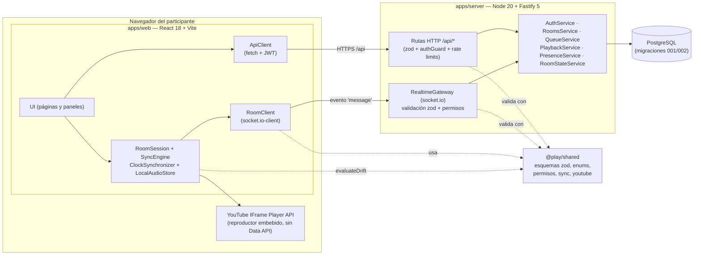
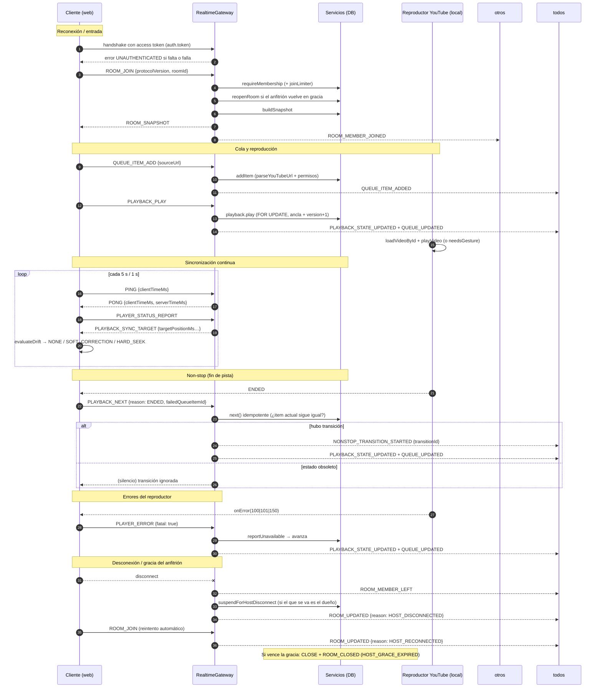

# 3. Arquitectura

> Documento: entregable 3 de §14 del prompt maestro.

---

## 3.1. Vista general

**Aviso:** el servidor **nunca** recibe, almacena ni retransmite audio de YouTube.
Solo coordina metadatos, cola, permisos y estado de reproducción; el audio se
reproduce localmente en cada navegador.

## 3.2. Componentes y responsabilidades

### Servidor (`apps/server`)

| Módulo | Archivo | Responsabilidad |
|---|---|---|
| Configuración | `src/config.ts` | Carga y valida **todas** las variables de entorno con zod; falla al arrancar si falta una obligatoria. |
| App / composición | `src/app.ts` | Fastify + helmet + CORS + socket.io (path `/ws`), health check, manejador de errores central, timers de gracia y presencia. |
| HTTP | `src/http/routes.ts` | Todas las rutas `/api/*`, con zod, `authGuard` y rate limits. |
| Auth | `src/modules/auth/*` | Registro/login con argon2id, JWT de acceso (jose), refresh token opaco con hash SHA-256 y rotación. |
| Salas | `src/modules/rooms/rooms-service.ts` | CRUD de salas, membresías, roles, invitaciones (hash + expiración + revocación), gracia del anfitrión (RF-01). |
| Instantánea | `src/modules/rooms/room-state-service.ts` | Construye `ROOM_SNAPSHOT` (sala + miembros + cola + reproducción + permisos). |
| Cola | `src/modules/queue/queue-service.ts` | Posiciones, estados, compactación, selección del siguiente reproducible, reintentos. |
| Reproducción | `src/modules/playback/playback-service.ts` | Transiciones **atómicas e idempotentes** bajo `SELECT … FOR UPDATE`, anclas temporales, repeat, `UNAVAILABLE`. |
| Presencia | `src/modules/presence/presence-service.ts` | Conteo de sockets por usuario y estados `CONNECTED/RECONNECTING/DISCONNECTED` (en memoria). |
| Gateway WS | `src/modules/realtime/realtime-gateway.ts` | Autenticación del handshake, validación zod de cada mensaje, permisos, emisión de eventos, rate limiting, `transitionId` estable. |
| Seguridad | `src/security/*` | argon2id, tokens opacos, hash SHA-256, `RateLimiter` de ventana deslizante. |
| Datos | `src/db/*` | Pool `pg`, migraciones versionadas, mappers fila→contrato. |
| Observabilidad | `src/logger.ts` | pino con redacción de `authorization`, `password`, `token`, `refreshToken`, `accessToken`. |

### Cliente (`apps/web`)

| Módulo | Archivo | Responsabilidad |
|---|---|---|
| API | `src/api/api-client.ts` | `fetch` contra `VITE_API_BASE_URL` con `Authorization: Bearer`. |
| Tiempo real | `src/realtime/room-client.ts` | socket.io-client (path `/ws`, transporte websocket), valida cada mensaje entrante con `serverMessageSchema`, genera `requestId`. |
| Sesión | `src/realtime/room-session.ts` | Máquina de estado de sala: aplica mensajes, reconcilia el reproductor, timers de PING (5 s) y reporte de estado (5 s), `needsGesture`. |
| Hook | `src/realtime/use-room.ts` | Une `RoomClient` + sesión; **el re-join vive en `onConnect`** (cada reconexión reenvía `ROOM_JOIN`). |
| Adaptador | `src/audio/youtube-adapter.ts` | Carga la IFrame Player API y la envuelve en la interfaz `AudioSourceAdapter`. |
| Reloj | `src/audio/clock-synchronizer.ts` | Muestras PING/PONG → offset de reloj (base epoch `Date.now`). |
| Sincronía | `src/audio/sync-engine.ts` | Evalúa deriva a 1 s y aplica seek suave/hard con enfriamiento. |
| Audio local | `src/audio/local-audio-store.ts` | Volumen/mute locales persistidos en el navegador; **nunca** emiten eventos de red. |

### Contratos compartidos (`packages/shared`)

`enums.ts` (valores canónicos), `schemas.ts` (esquemas zod de **todos** los
mensajes WS y entidades), `permissions.ts` (fuente única de verdad de permisos),
`sync.ts` (offset de reloj y `evaluateDrift`), `youtube.ts` (parseo local de URL),
`types.ts` (tipos TypeScript derivados).

## 3.3. Flujo de eventos de una sala

### Flujo resumido por fases

1. **Join** — autenticación en el handshake → `ROOM_JOIN` → membresía o
   invitación válida → `socket.join("room:<id>")` → `ROOM_SNAPSHOT` al entrante y
   `ROOM_MEMBER_JOINED` al resto.
2. **Snapshot** — sala, miembros (con estado de presencia), cola completa,
   estado de reproducción y `you.permissions` calculados **en el servidor**.
3. **Cola** — mutaciones validadas por permisos y resueltas en transacción; el
   orden se reenvía completo (`QUEUE_UPDATED`) para evitar divergencias.
4. **Play** — transición atómica bajo bloqueo de fila, nueva `version`, ancla
   (`anchor_position_ms`, `anchor_server_time_ms = Date.now()`).
5. **Sync** — PING/PONG + reportes; posición objetivo y correcciones en cliente.
6. **Non-stop** — `ENDED`/`ERROR` desde cualquier cliente, una sola transición,
   repeat `ALL`/`ONE`, salto de `UNAVAILABLE`.
7. **Reconexión/gracia** — re-join automático, presencia `RECONNECTING` →
   `DISCONNECTED`, suspensión y cierre de salas con gracia vencida.

## 3.4. Principios de autoridad (§7.3)

- **El servidor es autoritativo** para sala, permisos, cola, transiciones globales
  y la versión del estado. Toda mutación pasa por sus validaciones.
- **El reproductor local es autoritativo** para los eventos observables de ese
  cliente: `PLAYER_READY`, `PLAYER_STATUS_REPORT`, `PLAYER_ERROR` y el fin de
  pista. El servidor los contrasta contra el estado actual antes de actuar.
- **El volumen y el silencio nunca salen del cliente.** No existen mensajes de red
  `LOCAL_VOLUME_CHANGED` / `LOCAL_MUTE_CHANGED`.

## 3.5. Decisiones técnicas y alternativas descartadas

| Decisión | Alternativa descartada | Motivo |
|---|---|---|
| Socket.IO sobre HTTP (`path: "/ws"`) | WebSocket nativo | Reconexión, transporte y namespaces documentados; contrato único de eventos. |
| Estado compartido con anclas + versión | Mensajes "seek a X" a cada cliente | Permite que un cliente que llega tarde calcule su posición sin replay de eventos. |
| Presencia y rate limits en memoria | Redis desde el inicio | §7.1 prohíbe añadir infraestructura sin necesidad demostrada; el MVP es de **una** instancia. |
| Refresh token opaco + rotación | Sesión en cookie httpOnly | El access token se necesita también en el header del handshake WS. |
| Validación zod compartida | Tipos solo en TS | El servidor valida bytes de red reales; el cliente descarta mensajes malformados. |
| IFrame Player API (Opción B) | Data API / iframe simple | Ver `docs/01-viabilidad-youtube.md`. |
