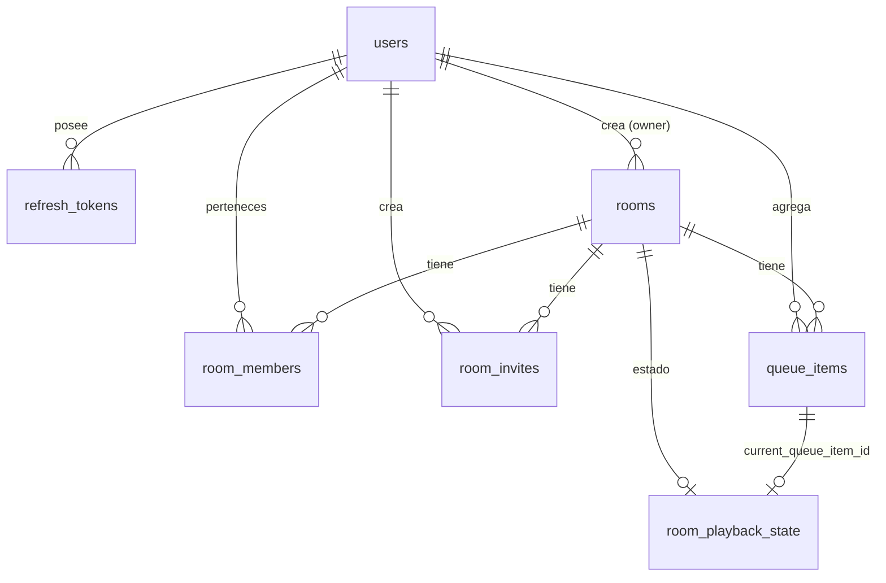

# 5. Modelo de datos y migraciones

> Documento: entregable 5 de §14 del prompt maestro.
> Fuente de verdad: `apps/server/migrations/001_init.sql` y
> `apps/server/migrations/002_repeat_mode_and_source_type.sql`.

---

## 5.1. Cómo aplicar las migraciones

Las migraciones son ficheros `.sql` ordenados alfabéticamente en
`apps/server/migrations/`. Cada fichero se divide en dos secciones separadas por
la línea exacta `-- DOWN`: lo anterior es el **up**, lo siguiente el **down**.
El migrador (`apps/server/src/db/migrate.ts`) exige que exista la sección
`-- DOWN` y registra cada fichero aplicado en la tabla `schema_migrations`
(id + `applied_at`), ejecutando cada migración dentro de `BEGIN/COMMIT` con
`ROLLBACK` ante cualquier fallo.

```bash
# desde la raíz del monorepo
npm run migrate          # aplica pendientes (up)
npm run migrate:test      # igual, pero contra play_test con variables predefinidas
npm run migrate:down -w @play/server   # revierte la última (paso por defecto 1)
```

> **Nota importante (verificada en el código):** `migrate.ts` **no** importa
> `dotenv/config`, por lo que `npm run migrate` **no lee el `.env` de la raíz**.
> Hay que exportar `DATABASE_URL` (y `JWT_SECRET`, porque `loadConfig` lo exige
> salvo en `NODE_ENV=test`) en el entorno del shell, o bien usar
> `npm run migrate:test`, que ya los fija. Ver `docs/07-pruebas.md`.

Cada fichero termina con un bloque `-- DOWN` que revierte lo hecho (drop de
índices, columnas y tablas con `IF EXISTS`).

## 5.2. Esquema ER



## 5.3. Tablas

### `users`

| Columna | Tipo | Restricciones |
|---|---|---|
| `id` | UUID | PK, `DEFAULT gen_random_uuid()` |
| `display_name` | TEXT | NOT NULL, `char_length BETWEEN 1 AND 60` |
| `email` | TEXT | NOT NULL |
| `password_hash` | TEXT | NOT NULL (argon2id) |
| `created_at` / `updated_at` | TIMESTAMPTZ | NOT NULL, `DEFAULT now()` |

Índice único: `users_email_lower_idx ON users (lower(email))`.

### `refresh_tokens`

| Columna | Tipo | Restricciones |
|---|---|---|
| `id` | UUID | PK |
| `user_id` | UUID | NOT NULL, FK `users(id)` `ON DELETE CASCADE` |
| `token_hash` | TEXT | NOT NULL (SHA-256) |
| `expires_at` | TIMESTAMPTZ | NOT NULL |
| `revoked_at` | TIMESTAMPTZ | nullable (rotación/logout) |
| `created_at` | TIMESTAMPTZ | NOT NULL, `DEFAULT now()` |

Índices: único `refresh_tokens_hash_idx (token_hash)`, `refresh_tokens_user_idx (user_id)`.
El token en claro nunca se almacena.

### `rooms`

| Columna | Tipo | Restricciones |
|---|---|---|
| `id` | UUID | PK |
| `name` | TEXT | NOT NULL, `char_length BETWEEN 1 AND 80` |
| `owner_user_id` | UUID | NOT NULL, FK `users(id)` `ON DELETE RESTRICT` |
| `privacy_mode` | TEXT | NOT NULL, `DEFAULT 'PRIVATE'`, `IN ('PRIVATE','UNLISTED')` |
| `control_mode` | TEXT | NOT NULL, `DEFAULT 'COLLABORATIVE'`, `IN ('HOST_ONLY','COLLABORATIVE','COLLABORATIVE_QUEUE_HOST_PLAYBACK')` |
| `nonstop_enabled` | BOOLEAN | NOT NULL, `DEFAULT true` |
| `max_participants` | INTEGER | NOT NULL, `DEFAULT 20`, `BETWEEN 2 AND 200` |
| `status` | TEXT | NOT NULL, `DEFAULT 'OPEN'`, `IN ('OPEN','CLOSED','SUSPENDED')` |
| `host_grace_until` | TIMESTAMPTZ | nullable (RF-01) |
| `created_at` / `updated_at` | TIMESTAMPTZ | NOT NULL, `DEFAULT now()` |
| `closed_at` | TIMESTAMPTZ | nullable |
| `repeat_mode` *(002)* | TEXT | NOT NULL, `DEFAULT 'OFF'`, `IN ('OFF','ALL','ONE')` |

Índices: `rooms_owner_idx (owner_user_id)`; parcial
`rooms_suspended_grace_idx (host_grace_until) WHERE status = 'SUSPENDED'` (002),
que acelera la búsqueda del vigilante de gracia.

### `room_members`

| Columna | Tipo | Restricciones |
|---|---|---|
| `id` | UUID | PK |
| `room_id` | UUID | NOT NULL, FK `rooms(id)` `ON DELETE CASCADE` |
| `user_id` | UUID | NOT NULL, FK `users(id)` `ON DELETE CASCADE` |
| `role` | TEXT | NOT NULL, `DEFAULT 'PARTICIPANT'`, `IN ('HOST','DJ','PARTICIPANT','OBSERVER')` |
| `joined_at` | TIMESTAMPTZ | NOT NULL, `DEFAULT now()` |
| `last_seen_at` | TIMESTAMPTZ | nullable |
| `left_at` | TIMESTAMPTZ | nullable (baja lógica) |

Restricción única: `UNIQUE (room_id, user_id)`. Índice: `room_members_room_idx (room_id)`.
Una membresía "activa" es `left_at IS NULL` (así se filtra en todas las consultas).

### `room_invites`

| Columna | Tipo | Restricciones |
|---|---|---|
| `id` | UUID | PK |
| `room_id` | UUID | NOT NULL, FK `rooms(id)` `ON DELETE CASCADE` |
| `token_hash` | TEXT | NOT NULL (SHA-256 del token opaco) |
| `expires_at` | TIMESTAMPTZ | NOT NULL |
| `revoked_at` | TIMESTAMPTZ | nullable |
| `created_by` | UUID | NOT NULL, FK `users(id)` `ON DELETE CASCADE` |
| `created_at` | TIMESTAMPTZ | NOT NULL, `DEFAULT now()` |

Índices: único `room_invites_hash_idx (token_hash)`,
`room_invites_room_idx (room_id)`, `room_invites_expiry_idx (expires_at)`.

### `queue_items`

| Columna | Tipo | Restricciones |
|---|---|---|
| `id` | UUID | PK |
| `room_id` | UUID | NOT NULL, FK `rooms(id)` `ON DELETE CASCADE` |
| `position` | INTEGER | NOT NULL, `>= 0` (se compacta a 0..n-1) |
| `source_type` | TEXT | NOT NULL, `DEFAULT 'YOUTUBE'`, `IN ('YOUTUBE')` |
| `source_url` | TEXT | NOT NULL (URL canónica guardada) |
| `external_content_id` | TEXT | NOT NULL, `char_length BETWEEN 1 AND 64` (ID del vídeo) |
| `title` | TEXT | nullable, `<= 200` (solo lo introduce el usuario) |
| `status` | TEXT | NOT NULL, `DEFAULT 'PENDING'`, `IN ('PENDING','CURRENT','PLAYED','SKIPPED','UNAVAILABLE','FAILED')` |
| `retry_count` | INTEGER | NOT NULL, `DEFAULT 0`, `>= 0` |
| `added_by` | UUID | NOT NULL, FK `users(id)` `ON DELETE RESTRICT` |
| `created_at` / `updated_at` | TIMESTAMPTZ | NOT NULL, `DEFAULT now()` |

Índices: `queue_items_room_position_idx (room_id, position)`,
`queue_items_room_status_idx (room_id, status)`.

### `room_playback_state`

| Columna | Tipo | Restricciones |
|---|---|---|
| `room_id` | UUID | PK, FK `rooms(id)` `ON DELETE CASCADE` |
| `current_queue_item_id` | UUID | FK `queue_items(id)` `ON DELETE SET NULL` |
| `playback_status` | TEXT | NOT NULL, `DEFAULT 'IDLE'`, `IN ('PLAYING','PAUSED','BUFFERING','IDLE','QUEUE_EMPTY','ERROR')` |
| `anchor_position_ms` | BIGINT | NOT NULL, `DEFAULT 0`, `>= 0` |
| `anchor_server_time_ms` | BIGINT | NOT NULL, `DEFAULT 0`, `>= 0` (epoch ms) |
| `playback_rate` | REAL | NOT NULL, `DEFAULT 1`, `> 0 AND <= 4` |
| `version` | BIGINT | NOT NULL, `DEFAULT 1`, `>= 1` (creciente en cada mutación) |
| `updated_by` | UUID | FK `users(id)` `ON DELETE SET NULL` |
| `updated_at` | TIMESTAMPTZ | NOT NULL, `DEFAULT now()` |
| `source_type` *(002)* | TEXT | NOT NULL, `DEFAULT 'YOUTUBE'`, `IN ('YOUTUBE')` |

### `room_events` (eliminada — migración 003)

El prompt define `room_events` como **opcional** y nunca se insertó ninguna
fila. La migración `003_drop_room_events.sql` la eliminó; el historial de
eventos queda solo en los logs estructurados del servidor.

### `schema_migrations` (creada por el migrador, no por las migraciones)

| Columna | Tipo |
|---|---|
| `id` | TEXT PK (nombre del fichero `.sql`) |
| `applied_at` | TIMESTAMPTZ NOT NULL DEFAULT now() |

## 5.4. Lo que **no** se persiste

- Volumen ni silencio locales (solo en `localStorage` del navegador, ver
  `LocalAudioStore`).
- Audio, cookies, tokens en claro (refresh e invitación se guardan con SHA-256).
- Metadatos de YouTube (título, duración, miniatura): no se consultan.
- Ningún dato de reproducción personal más allá de `added_by` y `updated_by`.

## 5.5. Política de retención

| Dato | Retención | Base |
|---|---|---|
| `refresh_tokens` | TTL configurable (`REFRESH_TOKEN_TTL_SECONDS`, 30 días) y revocación inmediata en rotación/logout. No hay poda automática programada. | Revocable siempre; conviene una tarea de limpieza en producción. |
| `room_invites` | TTL (`INVITE_TTL_SECONDS`, 7 días) + revocación manual. Filas conservadas hasta el borrado en cascada de la sala. | `expires_at`, `revoked_at` |
| `rooms` borradas | Borrado físico en cascada (`ON DELETE CASCADE` en miembros, invitaciones, cola, estado). | `DELETE /api/rooms/:roomId` |
| `room_members` | Baja lógica (`left_at`); se conserva la fila para historial de membresía. | §9 |
| `queue_items` | Viven mientras vive la sala (se compactan posiciones al borrar). | — |

## 5.6. Índices y rendimiento

- Todas las consultas de cola filtran por `(room_id, position)` o `(room_id, status)`.
- `rooms_suspended_grace_idx` es **parcial** (`WHERE status = 'SUSPENDED'`) y
  alimenta al vigilante que se ejecuta cada `HOST_SWEEP_INTERVAL_MS`.
- `users_email_lower_idx` hace único el email en minúsculas (el login normaliza
  con `toLowerCase()`).
- Los `LIMIT` de lista (`rooms` 100, `invites` 100, `members` 500, `queue` 500)
  acotan el coste de las instantáneas.
